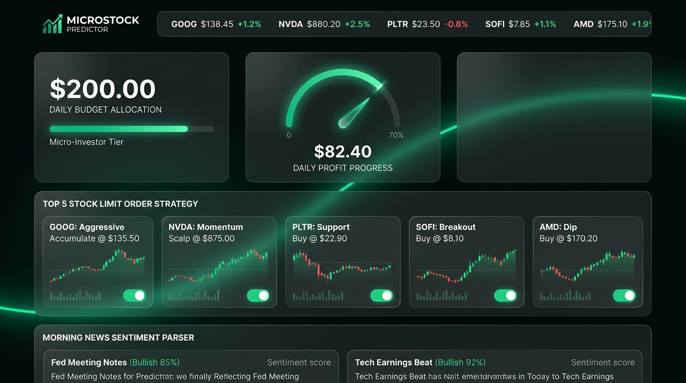

# 📈 MicroStock Predictor — AI Daily Stock Intelligence & Limit Order Strategy Engine

An interactive, AI-driven daily stock recommendation web application tailored specifically for **micro-investors** (daily budget $\le \$200$, targeting up to **$100 daily profit goal**). The app streams real-time market data from **Finnhub**, parses morning financial news feeds, measures catalyst positivity (`+`), predicts End-Of-Day (EOD) price targets, and builds an automated **5-Stock Portfolio Allocation Strategy** with exact **Take-Profit Limit Sell Orders**.


*MicroStock Predictor Dashboard showing $200 daily budget allocation, Top 5 limit order strategy, and $82.40 daily profit progress gauge.*

---

## ✨ Key Features

- **🔴 Live Finnhub Market Data Integration**:
  - Real-time stock quotes, session open/high/low/close prices, and day percentage changes directly via Finnhub API.
  - Live EST/EDT market clock showing active session state (`Pre-Market`, `Market Open`, `After-Hours`, `Weekend Closed`).
  - Auto-refresh polling every 60 seconds with manual one-click refresh button.
- **🎨 User Theme Switch**:
  - Light, Dark, or System mode available directly in the header to everyone — no admin login required.
  - The choice is saved in this browser and applied before first paint.
- **💰 $200 Micro-Investor Daily Budget Engine**:
  - Automatically splits your daily budget ($50 to $500, default **$200**) across 5 high-momentum picks (**$40 allocation per stock**).
- **📰 Real-Time Financial News & NLP Sentiment Parser**:
  - Pulls live market headlines and evaluates catalyst types: *Earnings Beat*, *FDA Approval*, *Analyst Upgrade*, *Partnership*, and *Retail Momentum*.
  - Assigns positivity ratings (`[+]`, `[0]`, `[-]`) and calibrated 0–100 sentiment scores.
  - Direct external links to original full articles on Reuters, Bloomberg, Yahoo Finance, and CNBC.
- **🎯 Dynamic Predictive EOD Price Targets & Signals**:
  - Computes momentum and sentiment-driven price targets in the format:
    `GOOG : [+] : Should go by 34% , currently at $50.00, may go upto $67.00 EOD`
- **⚡ Automated Take-Profit Limit Sell Orders**:
  - Calculates fractional share purchases and sets take-profit limit sell orders at predicted EOD targets (e.g., *"Buy 0.80 shares GOOG @ $50.00, Set Limit Sell @ $67.00"*).
- **🛡️ 5% Stop-Loss Downside Guard**:
  - Includes automated stop-loss protection triggers at 5% below entry price to cap daily risk.
- **🚀 One-Click Broker Order Execution Simulator**:
  - Transmits simulated limit sell orders directly into brokerage APIs (Robinhood / Fidelity / Schwab) with celebratory confetti.

---

## 🔑 API Key Setup & Configuration

This application connects to the **Finnhub Stock API** for live market quotes and market news feeds.

### 1. Obtain a Free Finnhub API Key
1. Visit [finnhub.io/register](https://finnhub.io/register) and create a free account.
2. Copy your API key from the Finnhub dashboard. The free tier includes 30–60 API calls per minute, which is sufficient for live quotes and news feeds.

### 2. Configure Your `.env` File
Create a `.env` file in the **root directory of the project**:

```bash
# Path: /home/opc/micro-stock-advisor/.env (or project root .env)
cp .env.example .env
```

Open `.env` and add your Finnhub API key:

```env
VITE_FINNHUB_API_KEY=your_finnhub_api_key_here
```

> [!IMPORTANT]
> **API Key Security & Git Exclusion:**
> - The `.env` file is listed in `.gitignore` and **must never be committed to Git**.
> - Do not hardcode your API key into any source files (`src/`).
> - The application automatically reads the key via Vite's `import.meta.env.VITE_FINNHUB_API_KEY`.
> - If no key is set or the API rate limit is reached, the application gracefully falls back to simulated offline datasets without crashing.

---

## 📊 Sample $200 Top 5 Daily Portfolio Output

| Ticker | Company | Positivity Rating | $200 Allocation | Current Price | Target EOD Price | Limit Sell Order | Est. Daily Profit |
| :--- | :--- | :--- | :--- | :--- | :--- | :--- | :--- |
| **GOOG** | Alphabet Inc. | `[+] Score 96` | **$40.00** (0.80 sh) | **$50.00** | **$67.00** (+34%) | `Set Limit @ $67.00` | **+$13.60** |
| **NVDA** | NVIDIA Corp. | `[+] Score 94` | **$40.00** (0.32 sh) | **$125.00** | **$156.25** (+25%) | `Set Limit @ $156.25` | **+$10.00** |
| **PLTR** | Palantir Tech | `[+] Score 91` | **$40.00** (1.42 sh) | **$28.00** | **$36.40** (+30%) | `Set Limit @ $36.40` | **+$12.00** |
| **SOFI** | SoFi Tech | `[+] Score 89` | **$40.00** (4.70 sh) | **$8.50** | **$11.05** (+30%) | `Set Limit @ $11.05` | **+$12.00** |
| **AMD** | Adv. Micro Devices | `[+] Score 88` | **$40.00** (0.28 sh) | **$140.00** | **$168.00** (+20%) | `Set Limit @ $168.00` | **+$8.00** |
| **TOTAL** | **5 Positions** | **Bullish** | **$200.00** | — | **$282.40 EOD** | **All Limits Placed** | <strong className="text-emerald-400">+$82.40 (+41.2% ROI)</strong> |

---

## 🚀 Quick Start / Installation & Execution

### Prerequisites

- **Node.js**: `v18.0.0` or higher (tested on `v20.20.2`)
- **npm**: `v9.0.0` or higher (tested on `10.8.2`)

### 1. Clone & Navigate to Project

```bash
git clone git@github.com:kesavanm/micro-stock-advisor.git
cd micro-stock-advisor
```

### 2. Install Dependencies

```bash
npm install
```

### 3. Configure Environment

```bash
cp .env.example .env
# Edit .env and enter your VITE_FINNHUB_API_KEY
```

### 4. Run Development Server

```bash
npm run dev
```

Open **`http://localhost:5173`** (or configured port) in your browser.

---

## 📦 Production Build & Deployment

```bash
# Build production bundle
npm run build

# Preview locally
npm run preview

# Deploy to Apache web root (e.g. on Oracle Cloud Infrastructure)
sudo cp -r dist/* /var/www/html/advisor/
```

---

## 🔐 Password-Protected Admin Panel

Open **`https://your-domain/advisor/#admin`** (or click the small ⚙ **Admin** link in the footer).

The panel lets you:

- **Refresh the trending cache** — re-runs the Finnhub morning-news scanner and updates the deployed cache.
- **Delete cache files** — removes `public/`, `dist/`, and deployed `trending-cache.json`.
- **Hard refresh (deploy dist)** — re-copies `index.html`, CSS, JS, and public files to Apache without rebuilding.
- **Remove stale assets** — deletes old hashed bundles that the current `index.html` no longer references.
- **Build & deploy new version** — runs `npm run build`, deploys the new bundle, and prunes stale assets.

> [!NOTE]
> Theme switching is no longer admin-only. Use the Light/Dark/System control in the dashboard header; no credentials required.

### 1. Configure the admin password

Add a strong password to `.env` (never commit it):

```env
ADMIN_PASSWORD=your-long-random-password
```

### 2. Start the admin API server

```bash
npm run admin
```

It listens on `127.0.0.1:8081` and reads `.env` automatically. To keep it running after logout/reboot, install the sample systemd unit:

```bash
sudo cp scripts/msp-admin.service /etc/systemd/system/
sudo systemctl daemon-reload
sudo systemctl enable --now msp-admin
```

### 3. Proxy the API through Apache

`/etc/httpd/conf.d/msp-admin.conf`:

```apache
<Location "/advisor/api/admin">
    ProxyPass "http://127.0.0.1:8081"
    ProxyPassReverse "http://127.0.0.1:8081"
</Location>
```

The build/deploy buttons use `sudo -n`, so the service user needs passwordless sudo for the copy commands — or set `ADMIN_USE_SUDO=0` if the deploy directory is writable by that user.

> [!NOTE]
> The admin API binds to `127.0.0.1` only. It is never exposed directly to the internet; Apache proxies it. Login attempts are rate-limited, and sessions expire after 8 hours.
>
> Long-running actions (build, deploy, cache refresh) are allowed up to **15 minutes**. This is aligned across Apache (`ProxyPass ... timeout=900`), Node (`requestTimeout`/`headersTimeout`), and the child-process timeouts in `scripts/admin-server.cjs`.

---

## 🛠️ Technology Stack

- **Core**: React 19, TypeScript 6, Vite 8
- **Data Provider**: Finnhub Real-Time Stock & News REST API
- **Styling**: Tailwind CSS CDN, Light/Dark Glassmorphism Design System
- **Charts & Animations**: Recharts, Canvas Confetti
- **Icons**: Lucide React

---

## 📄 License

MIT License — free for micro-investors and open-source developers!
